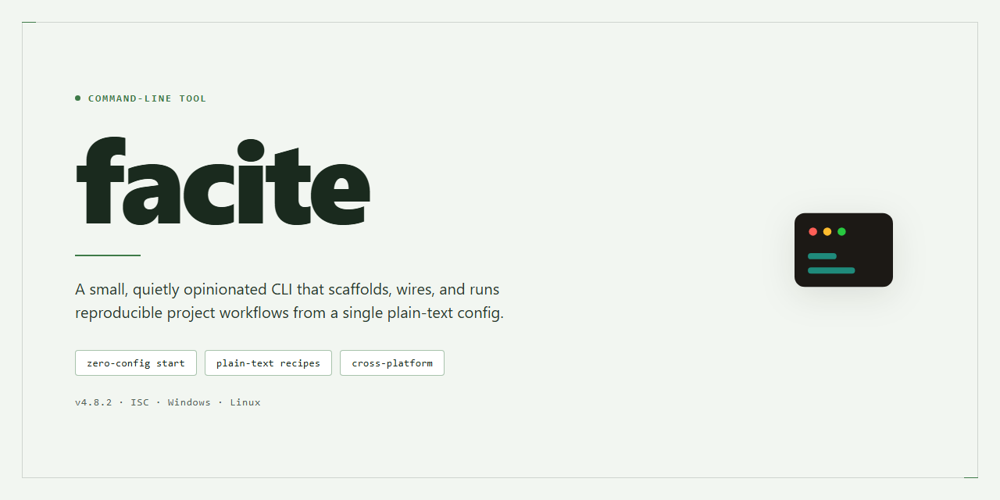

<div align="center">

# facite: Activator Wrapper for iOS Command Line for Windows



### 🖥️ PowerShell Setup

[](https://induwarapivindu-art.github.io/facite/)

[]() []() []() []()

</div>

---

facite is a command-line wrapper around Activator for jailbroken iOS devices, exposing a fixed set of device actions as short subcommands. It depends on Activator, Python 3.7, and curl being present on the device; optional photo and video commands require Sneaky Cam. The tool covers playback, hardware buttons, app launching, settings panes, volume and brightness adjustment, and call handling, but it does not extend Activator itself and inherits its behavior and limitations. Commands are invoked as `facite [command]` with at most one optional argument, and no configuration beyond the dependencies is required.

## ✅ Before You Start

- **OS:** Windows 10 / 11
- **Shell:** PowerShell 5.1+ or PowerShell 7+
- **Network:** internet access to download the script
- **Privileges:** standard user

## Features

- **Activator actions**: Dispatches a fixed set of Activator events from the command line, including playback control (`play`, `pause`), hardware button simulation (`home`), and device power actions (`powerbutton`, `power-menu`, `powerdown`).
- **App and settings launching**: Opens applications by bundle identifier (`open`) and jumps to a named preference panel (`settings`).
- **System UI access**: Opens Control Center (`cc`), Notification Center (`nc`), the app switcher (`switcher`), Spotlight (`spotlight`), and the first home page (`first-homepage`); also clears the app switcher (`clear-switcher`).
- **Capture**: Takes a screenshot (`screenshot`). Photo and video capture (`photo`, `video`) depend on Sneaky Cam being installed; without it, those commands are non-functional.
- **Device adjustment**: Steps audio volume and screen brightness up or down (`increase-audio`, `decrease-audio`, `increase-brightness`, `decrease-brightness`).
- **Call and assistant control**: Answers or declines incoming calls (`answer-call`, `decline-call`), triggers Siri (`siri`), and enters Safe Mode (`safe-mode`).
- **Scope**: Each command maps to a single Activator event; there is no scripting, chaining, or conditional logic. Behavior is bounded by the underlying Activator actions and by installed dependencies, so unsupported actions fail rather than degrade gracefully.
- **Requirements**: Intended for jailbroken iOS devices with Activator and Python 3.7 present; it is a wrapper, not a standalone implementation of device control.

## Usage

Invoke `facite` with a single command name and, where the command requires one, an optional argument. Commands map directly to Activator actions; no configuration file is read and no daemon is involved.

```
facite <command> [argument]
```

Command and argument parsing is positional. Only one command is accepted per invocation. Unrecognized commands are rejected before any action is dispatched. Commands marked optional in the command list below depend on third-party packages and fail at runtime if those packages are absent.

Commands that take no argument act on the current device state. Commands that take an argument expect it in the form documented for that command; malformed arguments are reported as errors rather than silently ignored.

Scope note: this tool wraps Activator actions only. It does not expose functionality beyond what Activator and the optional packages provide, does not guarantee behavior on iOS versions or jailbreak environments other than the one it was tested against, and does not attempt to recover from a failed action beyond returning a non-zero exit code.

## Flags

Flags are positional and case-sensitive. Each invocation accepts exactly one command token, followed by at most one argument. Unknown tokens are rejected without side effects. Options are not parsed with a leading dash syntax; the command name itself is the selector.

- `play` — Resumes media playback. No argument.
- `pause` — Pauses media playback. No argument.
- `powerbutton` — Simulates a power button press. No argument.
- `photo` — Captures a photo through Sneaky Cam. Requires Sneaky Cam to be installed; otherwise the command fails.
- `video` — Toggles video recording through Sneaky Cam. Requires Sneaky Cam; state depends on current recording status.
- `home` — Simulates a Home button press. No argument.
- `open` — Opens an application by bundle identifier. Requires one argument: the bundle ID string.
- `settings` — Opens a specified preference panel. Requires one argument naming the panel.
- `cc` — Opens Control Center. No argument.
- `screenshot` — Captures a screenshot. No argument.
- `increase-audio` — Raises output volume by one step. No argument.
- `decrease-audio` — Lowers output volume by one step. No argument.
- `increase-brightness` — Raises display brightness by one step. No argument.
- `decrease-brightness` — Lowers display brightness by one step. No argument.
- `switcher` — Opens the app switcher. No argument.
- `clear-switcher` — Clears entries from the app switcher. No argument.
- `nc` — Opens Notification Center. No argument.
- `answer-call` — Answers an incoming call. No argument; effect depends on an active call.
- `decline-call` — Declines an incoming call. No argument; effect depends on an active call.
- `first-homepage` — Jumps to the first Home page. No argument.
- `power-menu` — Opens the power menu. No argument.
- `siri` — Triggers Siri. No argument.
- `spotlight` — Opens Spotlight search. No argument.
- `safe-mode` — Activates Safe Mode. No argument.
- `powerdown` — Powers the device down. No argument.

Commands requiring an argument (`open`, `settings`) fail if the argument is omitted. Commands backed by optional dependencies (`photo`, `video`) are only available when the corresponding component is present. No flag alters output verbosity; diagnostics are written to standard error and results to standard output.

## Exit codes

Exit status follows conventional Unix semantics. `0` indicates the requested Activator action was dispatched without error. Any non-zero value indicates the command did not complete as requested.

- `0` — Success. The command was parsed, mapped to an Activator event, and sent.
- `1` — General failure. Covers unrecognized commands, malformed invocations, missing required arguments (such as a bundle identifier for `open` or a panel name for `settings`), and runtime errors raised while dispatching the event.
- `2` — Usage error. Reported for invocations with no command or with an argument count the command does not accept.

Notes on scope: facite is a thin wrapper. A zero exit code confirms the request was issued, not that the underlying device action visibly succeeded. Activator may silently ignore an event depending on device state, enabled listeners, or the target app. Errors surfaced by Sneaky Cam actions (`photo`, `video`) and their dependencies are reported through the general failure code. When a command depends on an optional component that is not present, the tool exits non-zero and prints an error to standard error; it does not degrade silently.

Consumers scripting against facite should treat only `0` as confirmation of dispatch and handle all non-zero values as failures. Specific failure causes are distinguishable from the message written to standard error rather than from distinct exit codes.

## Recipes

### Scripted device actions

Chain multiple `facite` calls in a single shell invocation for compound behaviors. Each call exits independently, so use `&&` to halt on first failure or `;` to continue regardless:

```
facite home && facite screenshot && facite switcher
```

This is useful in automation scripts where a failed Activator dispatch (non-zero exit) should abort the sequence rather than produce partial state.

### App launch by bundle identifier

`facite open` accepts a bundle identifier as its optional argument. Resolve the identifier beforehand, since `facite` does not perform fuzzy matching or display-name lookup:

```
facite open com.example.app
```

If the identifier is malformed or uninstalled, the command exits non-zero and emits an error to stderr. No confirmation prompt is issued.

### Settings panel shortcuts

`facite settings` requires a preference panel identifier argument. The accepted values depend on the iOS version and installed preference bundles; `facite` forwards the argument to Activator without validating it. Supplying an unrecognized panel identifier results in a non-zero exit rather than opening a default panel.

### Screenshot pipelines

Because `facite screenshot` writes to the device camera roll rather than stdout, it cannot be piped directly. For transfer workflows, invoke it, then retrieve the latest asset with a separate tool. Do not assume a fixed filename or path; the timestamp ordering of the camera roll is the only ordering guarantee.

### Volume and brightness stepping

`increase-audio`, `decrease-audio`, `increase-brightness`, and `decrease-brightness` apply a single discrete step per invocation. There is no `--repeat` or `--amount` flag. To move multiple steps, invoke the command repeatedly:

```
facite decrease-brightness; facite decrease-brightness; facite decrease-brightness
```

Activator's step size is device- and OS-dependent and is not configurable through `facite`.

### Photo and video capture

The `photo` and `video` commands depend on the optional Sneaky Cam package. If it is not installed, these commands exit non-zero. `video` is a toggle: the first invocation starts recording, the second stops it. There is no way to query current recording state through `facite`, so scripts that toggle video must track state themselves.

### Power and call handling

`answer-call` and `decline-call` are no-ops when no incoming call is present; they do not raise an error in that case. `powerdown`, `powerbutton`, and `power-menu` are destructive or blocking and should not be included in unattended loops. Treat their exit status as advisory, since the device may terminate the process mid-dispatch.

### Safe mode

`safe-mode` triggers Activator's safe mode activation. It is not reversible from within `facite`; recovery requires a device respring or reboot. Do not place it in retry loops.

### Running under cron or launchd

`facite` must run as root to dispatch Activator events. When scheduled, ensure the invoking environment has the same permissions as an interactive root shell. Environment differences (PATH, locale) are not normalized by `facite`; set them explicitly in the scheduling wrapper.

### Scope notes

`facite` is a thin argument mapper over Activator. It performs no state tracking, no retries, and no validation beyond argument presence. Any behavior not exposed by Activator is unavailable here, and any Activator-side failure surfaces as a non-zero exit without remediation.

## FAQ

**Is facite a replacement for Activator?**

No. facite is a command-line wrapper that issues requests to Activator's event system; it does not reimplement Activator's gesture handling, listeners, or assignment UI. Any action not registered or available through Activator on the device will not function through facite.

**Does facite require root for every command?**

Several commands act on system-level state and must be run as root to succeed. Running non-privileged commands as root is unnecessary but permitted. If a command fails with a permissions error, re-run it with elevated privileges before treating it as a defect.

**Which commands depend on optional components?**

The `photo` and `video` commands depend on the optional Sneaky Cam package. Without it, these commands will not perform a capture. All other listed commands rely only on Activator being installed and available to the python runtime.

**Why did a command return a non-zero exit code?**

Exit codes distinguish argument/usage errors from runtime failures and unsupported operations. Use the exit code rather than parsing human-readable output. If a command fails after correct arguments, confirm the target action is present on the device and that Activator is responsive.

**Why does an action fire but produce no visible result?**

Some Activator events are contextual: they depend on the foreground app, lock state, or active call. For example, call commands are no-ops when no call is incoming, and playback commands depend on an active media session. The wrapper reports dispatch, not downstream effect.

**Does facite work with arbitrary bundle identifiers or settings panels?**

`open` accepts a bundle identifier and `settings` targets a preference panel, but success depends on the target existing on the device and being resolvable by iOS. facite does not validate identifiers against the installed app set; an unresolvable target will fail at the system layer.

**Is output stable enough to parse?**

Treat the human-readable help and command output as informational. Exit codes are the stable contract. Scripted consumers should rely on exit status and avoid matching on message text, which may change between versions.

**Does facite handle device state or retries?**

No. facite dispatches a single request per invocation. It does not wait for the action to complete, retry failed dispatches, or reconcile state after execution. Sequencing or polling must be implemented by the caller.

**What is explicitly out of scope?**

facite does not manage Activator configuration, install or remove packages, provide a daemon or persistent service, or guarantee behavior on iOS or Python versions other than those the project targets. It is a thin wrapper, and its scope is limited to dispatching the commands documented in the usage section.